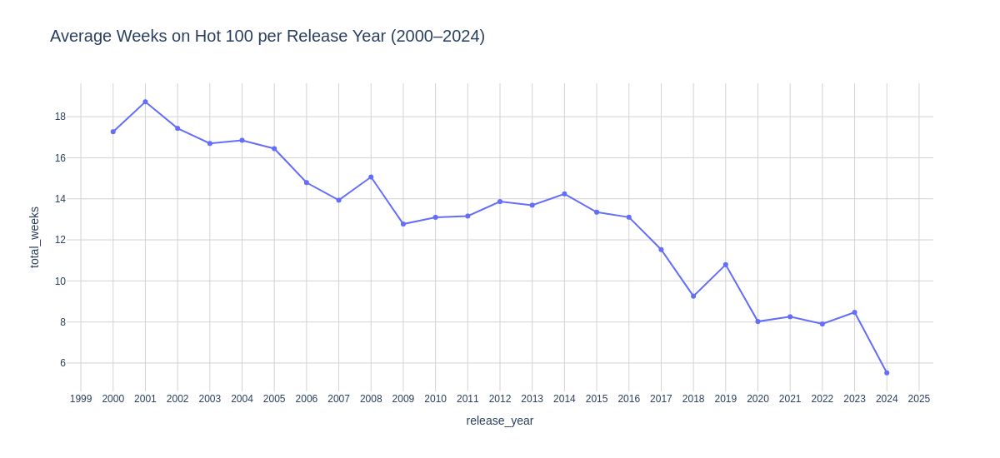
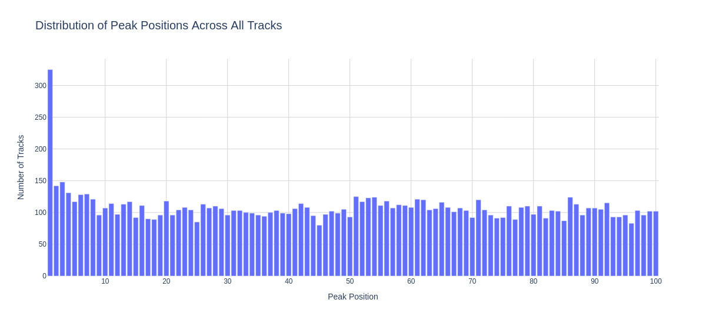
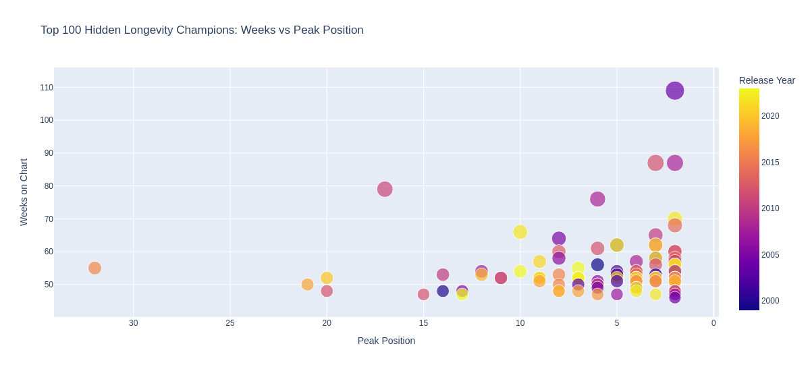
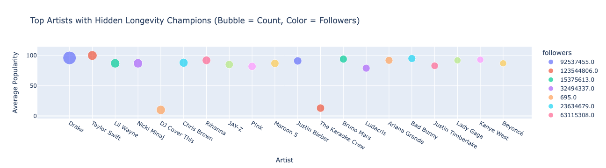

# Hidden Longevity Champions of the Hot 100

A data story about the songs that never reached #1 but stayed on the Billboard Hot 100 for months. Built as a magazine-style analysis of 25 years of chart data, from the CD era to streaming.

**Hyper Island · Python Programming · January 2026 · Pass with Distinction**



## Key findings

| | |
|---|---|
| **#1 hits are rare** | Only 325 of 10,783 charting tracks (3%) ever reached #1 |
| **Hidden champions are common** | 2,973 tracks (28%) charted for 20+ weeks without ever reaching #1 |
| **Streaming shortened chart life** | Average time on the chart fell 37%, from 14.8 weeks (pre-2015) to 9.3 weeks (2015 onwards) |
| **Longest hidden champion** | *1, 2 Step* (Ciara feat. Missy Elliott): 109 weeks, peaking at #2 |
| **Top artists** | Drake (30 hidden champions) and Taylor Swift (15) |

## What a hidden champion looks like

Across the 2,973 hidden champions:

- **73% are clean** rather than explicit, which suits radio and playlists
- **84% come from full albums** rather than singles
- **About 3.8 minutes long**, with typical lengths between 3.3 and 4.1 minutes
- **Moderately danceable (0.64) and energetic (0.68)**, with a balanced emotional tone (valence 0.53)
- **No strong seasonal pattern** in when they first enter the chart





## Approach

The analysis follows a three-layer structure, moving from the whole chart to individual songs and artists:

| Layer | Question | Data joined |
|---|---|---|
| **1. Broad trends** | How long do songs stay on the chart, and how has that changed? | Chart positions + tracks |
| **2. Segment patterns** | What do hidden champions have in common? | + artist mapping + Spotify audio features |
| **3. Spotlight heroes** | Which songs and artists stand out? | + artist popularity and followers |



## Data

Five tables from Hyper Island's BigQuery course dataset:

| Table | Rows | Contents |
|---|---|---|
| `chart_positions` | 129,305 | Weekly Hot 100 positions, January 2000 to October 2024 (1,294 chart weeks) |
| `tracks` | 11,070 | Track metadata: release date, duration, album type, explicit flag |
| `audio_features` | 10,783 | Spotify audio features: danceability, energy, valence, tempo and more |
| `artists` | 3,108 | Artist name, popularity and followers |
| `tracks_artists_mapping` | 15,048 | Links tracks to their artists |

**Cleaning steps included:** standardising partial release dates, removing duplicate tracks, converting durations, replacing invalid time signatures, flagging duplicate artist names, and fixing swapped columns in the track–artist mapping table.

The dataset is not public, so it is not included and the notebook can't be re-run without course access. All outputs and charts are saved in the notebook.

## Limitations

- **Eras are split by release year** (up to 2014 vs 2015 onwards), so older songs that re-entered the chart later count towards their original era.
- **Some cover and karaoke versions** (such as "DJ Cover This" and "The Karaoke Crew") appear among the top artists, which suggests that some covers were matched to the original songs. A next step would be to filter these out.
- **Thresholds are judgement calls:** "hidden champion" means 20+ weeks and a peak below #1. Different cut-offs would change the counts but not the overall pattern.

## Repository structure

```
hidden_longevity_champions.ipynb   Full analysis with outputs and interactive Plotly charts
images/                            Static chart images for this README
requirements.txt                   Python packages used
```

## Built with

Python · pandas · Plotly · Google BigQuery · Jupyter
